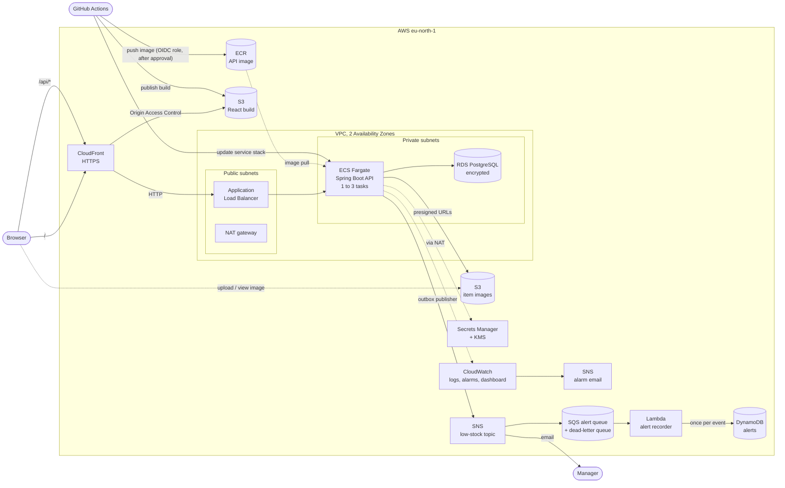

# InventoryApp

A web application where staff track stock levels, record stock movements, import items from CSV, and see an alert when an item falls to its reorder level. It runs on AWS and is deployed by a GitHub Actions pipeline.

**Live (sandbox):** https://d1v2v55o96jhmt.cloudfront.net. It may be scaled down to save cost; see [Deploying](#deploying).

## Features

- **Sign-in and roles:** Admin, Staff and Viewer, with JWT access and refresh tokens. A first-time or reset password must be changed before anything else.
- **Items:** create, edit, search, filter (category, low stock, attributes, delivery pincode, price range), sort and page. Only an Admin can delete, and deleting keeps the SKU reserved.
- **Stock movements:** stock in, stock out and adjustments with a reason, plus a history per item. A stock-out larger than the stock is refused, also when two people change stock at the same moment.
- **Item images:** uploaded with a stock-in, straight from the browser to S3.
- **Low-stock alerts:** recorded when a change takes an item to or below its reorder level, listed on the Alerts page, and emailed to the manager.
- **CSV import:** create, update or restore items in bulk, with row-numbered errors for bad rows.
- **Dashboard:** stock totals, low-stock count and recent movements.
- **Users (Admin):** create users and reset passwords with one-time temporary passwords.

## Architecture



- The browser only talks to **CloudFront**: it serves the React app from a private bucket and forwards `/api/*` to the load balancer, so there is one HTTPS address and no CORS for the API.
- The **API** and **database** sit in private subnets; only the load balancer is reachable from the internet, and only the API's security group can reach the database.
- **Images** go straight between the browser and S3 through short-lived presigned URLs that the API issues.
- **Low-stock alerts** are written in the same transaction as the stock change (outbox), then published to SNS, which emails the manager and queues them in SQS for a Lambda that records each one once in DynamoDB.
- **Secrets** (database credentials, JWT signing key, first Admin) come from Secrets Manager and are injected into the tasks.
- **GitHub Actions** deploys with short-lived credentials from an OIDC role, only after a reviewer approves the `sandbox` environment.

The decisions behind this, and what is planned but not built yet, are in the [design note](docs/design-note.md).

## Repository layout

| Path | Contents |
|---|---|
| `api/` | Java 17 / Spring Boot REST API (PostgreSQL, JWT, OpenAPI) |
| `web/` | React front end |
| `infra/` | AWS infrastructure as CloudFormation templates, one stack per concern |
| `docs/` | Design note, backlog, lessons learned, security review |
| `.github/` | CI/CD workflows and PR template |

## Tech stack

- **Back end:** Java 17, Spring Boot, PostgreSQL, Flyway, Spring Security (JWT), springdoc-openapi
- **Front end:** React (functional components and hooks), React Router, MUI, Vite, Vitest and Testing Library
- **AWS:** ECS Fargate, ALB, ECR, RDS PostgreSQL, S3, CloudFront, Secrets Manager, KMS, CloudWatch, SNS, SQS, Lambda, DynamoDB, CloudTrail, CloudFormation, IAM, Application Auto Scaling. Planned: API Gateway for reading alerts ([design note](docs/design-note.md#4-deferred-work)).
- **CI/CD:** GitHub Actions with OIDC to AWS

## Prerequisites

- Java 17 (Temurin)
- Node.js and npm (for `web/`)
- A Docker runtime. On macOS we use [Colima](https://github.com/abiosoft/colima) instead of Docker Desktop:
  ```bash
  brew install colima docker && colima start
  ```
  Then add these to `~/.zshrc` so Testcontainers and Spring Boot find Colima:
  ```bash
  export DOCKER_HOST=unix://$HOME/.colima/default/docker.sock
  export TESTCONTAINERS_DOCKER_SOCKET_OVERRIDE=/var/run/docker.sock
  ```

## Running locally

### API (`api/`)

The first Admin is created at startup from two environment variables (only if no Admin exists yet). Choose your own values; never commit them.

```bash
cd api
export INVENTORY_ADMIN_USERNAME=admin
export INVENTORY_ADMIN_PASSWORD='choose-a-strong-password'
./mvnw spring-boot:run
```

Spring Boot starts Postgres and S3Mock (local S3 for item images, port 9090) from `compose.yaml`. The API runs on `http://localhost:8080`:

- Swagger UI: `http://localhost:8080/swagger-ui.html`
- Health: `http://localhost:8080/actuator/health`
- Postman: import the files in `api/postman/`

Run the tests (Postgres is started by Testcontainers):

```bash
./mvnw verify
```

### Web (`web/`)

Start the API first, then:

```bash
cd web
npm install
npm run dev
```

Open `http://localhost:5173` and sign in with the Admin from `INVENTORY_ADMIN_USERNAME` / `INVENTORY_ADMIN_PASSWORD`. Vite forwards `/api/*` to `http://localhost:8080`; set `VITE_API_URL` to use another address.

To work on the UI without the API, run `npm run dev:mock`. It answers `/api/*` from fake data in `src/mocks/handlers.js` (users `admin/admin123`, `staff/staff123`, `viewer/viewer123`).

Run the tests and checks:

```bash
npm test
npm run lint
npm run build
```

## Quality gate (SonarCloud)

Every pull request is analysed by [SonarCloud](https://sonarcloud.io) using the default "Sonar way" quality gate, which needs at least 80% test coverage on new code. CI uploads the coverage from `./mvnw verify` (JaCoCo) and `npm run test:coverage` (Vitest), and the **SonarCloud - quality gate** check fails if the gate fails.

Run the same coverage locally:

```bash
cd api && ./mvnw verify            # api/target/site/jacoco/index.html
cd web && npm run test:coverage    # web/coverage/lcov-report/index.html
```

One-time setup (already done for this repository; needed again only for a fork):

1. Sign in at sonarcloud.io with GitHub and import this repository (free for public repositories).
2. In the SonarCloud project, turn off **Automatic Analysis** (Administration → Analysis Method), because CI runs the analysis.
3. Create a token (My Account → Security) and add it to the GitHub repository as the secret `SONAR_TOKEN` (Settings → Secrets and variables → Actions).
4. Check that `sonar.organization` and `sonar.projectKey` in `sonar-project.properties` match the SonarCloud project.

## Deploying

The app runs in AWS (`eu-north-1`) at the `WebUrl` output of the `inventory-frontend` stack (`https://<id>.cloudfront.net`). CloudFront serves the React build from S3 and sends `/api/*` to the API behind the load balancer.

When CI passes on `main`, `.github/workflows/deploy.yml` waits for approval in the `sandbox` environment. It then builds the API image, stops on any HIGH or CRITICAL vulnerability, rolls the image out (a failed rollout is rolled back automatically), publishes the web app and smoke-tests both. The stacks, the order to create them in, and how to stop and start the API are in [infra/README.md](infra/README.md).

## Ways of working

- Never commit directly to `main`. Every change goes through a feature branch and a pull request.
- GitHub enforces this with the `main` ruleset (Settings → Rules → Rulesets): no direct pushes, force pushes or deletion. A pull request can only merge when `Web - lint, test, build`, `API - test and build` and `SonarCloud - quality gate` have passed on its latest commit, and all review conversations are resolved. Nobody can bypass it, not even the repository owner.
- Reviews: the project has one developer, and GitHub does not let authors approve their own pull requests, so the ruleset requires 0 approvals. Instead, every pull request gets a self-review against its checklist. Raise it to 1 when a second person joins.
- Branch names: `feature/INV-<n>-short-description` (or `fix/`, `chore/`).
- Commit messages: `INV-<n>: Short imperative summary`, for example `INV-12: Add reorder-level validation`.
- No passwords, keys or tokens in code, commits or screenshots.

## Documentation

- [Design note](docs/design-note.md)
- [Backlog](docs/backlog.md)
- [Lessons learned](docs/lessons-learned.md), including the failed deployment exercise (INV-28)
- [Security review](docs/security-review.md): IAM, CloudTrail and secrets (INV-29)
- [Performance and accessibility](docs/performance.md): 10,000-item load test and Lighthouse against A9 (INV-30)
- [Demo and clean-up](docs/demo.md): demo script, and how to scale the sandbox down and up again (INV-32)
